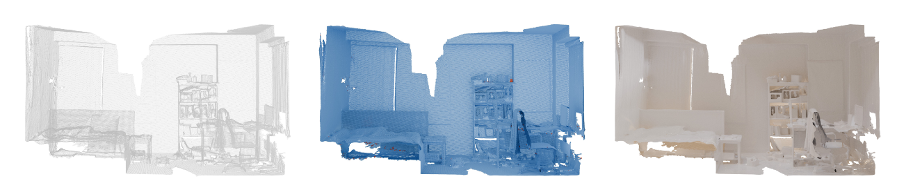
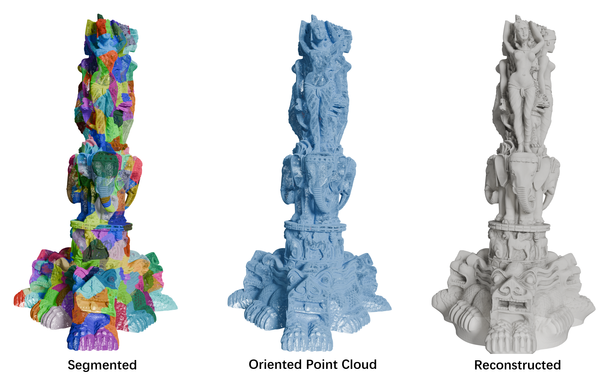

# A Divide-and-Conquer Approach for Global Orientation of Non-Watertight Scene-Level Point Clouds Using 0-1 Integer Optimization(DACPO)

This paper is published at ACM Transactions on Graphics (SIGGRAPH 2025). Please refer to our [paper](https://arxiv.org/abs/2505.23469).



### Tested Platforms

- Windows 11
- Visual Studio 2022
- 11th Gen Intel(R)Core(TM)i9-11900K 3.50GHz
- 64GB RAM
- Linux with CMake, GCC, PCL, Eigen3, Boost, and OpenMP

### Dependencies
#### For DACPO main project
- PCL
- Eigen
- Boost
- OpenMP

The PSR implementation used by DACPO is based on [PoissonRecon](https://github.com/mkazhdan/PoissonRecon).

**1. PCL**

Install using vcpkg.

`vcpkg install pcl:x64-windows`

`vcpkg integrate project`

After executing `vcpkg integrate project`, you will see a prompt:

> With a project open, go to Tools->NuGet Package Manager->Package Manager Console and paste:
> Install-Package "vcpkg.D.sdk.vcpkg" -Source "{your vcpkg path}"

Follow the instructions as prompted.

**2. Eigen**

Install using vcpkg:

`vcpkg install Eigen3:x64-windows`

`vcpkg integrate project`


**3. Boost**

Install using vcpkg:

`vcpkg install boost:x64-windows`

`vcpkg integrate project`

**4. OpenMP**

OpenMP is required by the CMake build. On Windows, install it through Visual Studio. On Linux, install the OpenMP runtime for your compiler, for example `libomp-dev` for Clang or the GCC OpenMP package provided by your distribution.

#### For graphical_model Python tools

The 0-1 integer optimization service and visualization helpers use Python dependencies listed in `graphical_model/requirements.txt`:

```bash
cd graphical_model
pip install -r requirements.txt
```


**Build with CMake**

After installing the dependencies, you can build the solution by using the following steps.

1. **Create build directory:**
```bash
# Using vcpkg toolchain on Windows
cmake -S . -B build -DCMAKE_BUILD_TYPE=Release -DCMAKE_TOOLCHAIN_FILE=[path_to_vcpkg]/scripts/buildsystems/vcpkg.cmake

# Or use system/default packages
cmake -S . -B build -DCMAKE_BUILD_TYPE=Release

cmake --build build --config Release -j 4
```

DACPO requires C++17. The executable is written to `build/bin/Release/DACPO` on multi-config generators or `build/bin/DACPO` on single-config generators.


**Configure Header and Library Paths**

In all configurations for DACPO main project, set the VC++ directory include paths:

```
include:
src/include
src/include/3dparty
```

#### 0-1 Integer Optimization API
Since DACPO uses gurobi to solve the 0-1 integer optimization problem, you need to start a gurobi service before running the code.
```
cd graphical_model
pip install -r requirements.txt
python socket_server_para.py
```
If you see the following prompt, the gurobi service is running.
```
start comb server
Server listening on 0.0.0.0:11111
```


### Usage
>Note: Before running the code, you need to start the gurobi service following the instructions in the [0-1 Integer Optimization API](#0-1-integer-optimization-api) section.

```
{Path to DACPO.exe} --in {scene name} --iters 0 --depth 10 --neighbors 10 --seed 10 --input_data_root {Path to your scene folder} --ipsr_type 2 --config_folder {Path to conf}
```
Example:
```bash
OMP_NUM_THREADS=4 ./build/bin/Release/DACPO \
  --in scene0600_00_vh_clean_2 \
  --iters 10 --depth -1 --neighbors 10 --seed 10 \
  --input_data_root data/scannetv2_maxpart/val/ \
  --out_data_root data/out/current_val_it10_dp-1 \
  --ipsr_type 2 \
  --config_folder conf/default \
  --psr_threads 10
```

Usage:
--in: scene name

--iters: number of iterations

--depth: depth of octree downsampling in each block.-1 means no downsampling

--neighbors: number of neighbors in knn graph

--seed: random seed

--input_data_root: path to scene folder

--out_data_root: path to output folder

--ipsr_type: 0: ipsr the whole scene, 2: ipsr each block

--config_folder: path to conf folder, please use /conf/default

--psr_threads: number of threads used by each PoissonRecon call

We recommend setting `--psr_threads` explicitly, especially on Linux. In our tests, allowing too many concurrent PSR threads made the PSR stage slower rather than faster. We have not deeply profiled the PSR implementation, but on our test machine `--psr_threads 10` was a conservative starting point. When running many scenes in parallel, reduce this value together with `OMP_NUM_THREADS` to avoid oversubscription.


### Dataset
Our code can process a single scene in a single ply file.
Batch preprocess dataset and batch running code will be released later. For now, batch runs can be launched by wrapping the single-scene CLI in a shell or Python script.

#### ScanNet
Please refer to [ScanNet](https://github.com/ScanNet/ScanNet)

#### SceneNN
Please refer to [SceneNN](https://github.com/zhaoyu-zhao/SceneNN)

### Result on watertight-model



Our method can also apply on watertight pointcloud model.


### Citation

If you find this work useful in your research, please consider citing:

```bibtex
@misc{li2025divideandconquerapproachglobalorientation,
      title={A Divide-and-Conquer Approach for Global Orientation of Non-Watertight Scene-Level Point Clouds Using 0-1 Integer Optimization}, 
      author={Zhuodong Li and Fei Hou and Wencheng Wang and Xuequan Lu and Ying He},
      year={2025},
      eprint={2505.23469},
      archivePrefix={arXiv},
      primaryClass={cs.CV},
      url={https://arxiv.org/abs/2505.23469}, 
}
```
